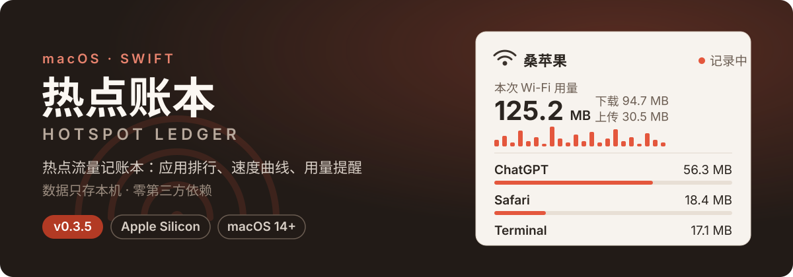
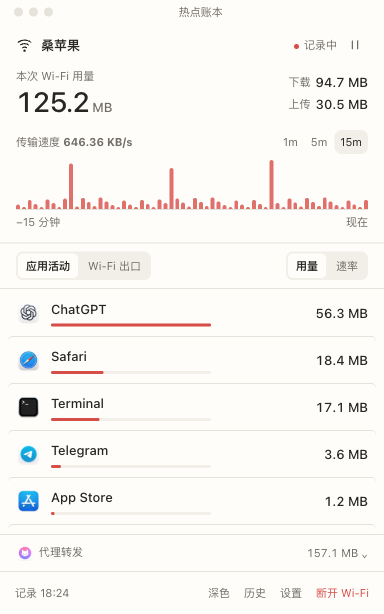
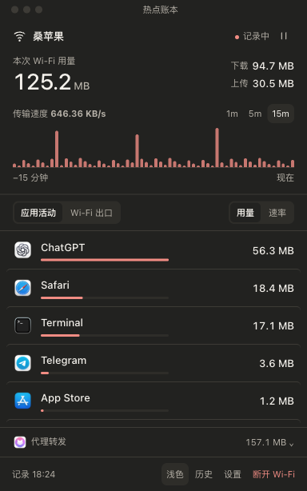

<p align="right"><a href="README.md">中文</a></p>

<p align="center">
  
</p>

<p align="center">
  <a href="https://xiaosang.cc/hotspot-ledger/">🌐 Product Page</a>
  ·
  <a href="https://github.com/holynova/hotspot-ledger/releases/tag/v0.3.5">⬇ Download v0.3.5 (Mac)</a>
  ·
  <a href="https://github.com/holynova/hotspot-ledger">GitHub Repository</a>
</p>

Hotspot Ledger is a local macOS app that tracks how much data your Mac uses over a phone hotspot. Connect to a hotspot and it ranks apps by traffic, charts your speed, alerts you at usage thresholds, and can disconnect Wi-Fi manually or automatically. All data stays on your machine — nothing is uploaded.

## Screenshots

<p align="center">
  
  
</p>

## Features

- **Per-app ranking**: traffic listed by app, with real app icons; helper processes are merged by bundle path.
- **Speed chart**: a dense bar chart of live transfer speed, hover for upload/download, 1m / 5m / 15m ranges.
- **Usage alerts**: 500 MB cumulative and 100 MB in 60 seconds by default (set 0 to disable either).
- **Disconnect protection**: turn Wi-Fi off manually, or enable auto-disconnect (off by default, with its own threshold defaulting to 1000 MB, at most once per connection, with the Wi-Fi name re-verified before acting).
- **Session resume**: restarting on the same hotspot name and interface resumes the last interrupted record; traffic while the app was closed is never counted.
- **History**: past sessions saved per connection, switchable from 「历史」 ("History") at the bottom.
- **Proxy separation**: Clash / Mihomo forwarded traffic is labeled 「代理转发」 ("Proxy Forward") separately — never attributed to source apps, never added to the egress total.
- **Menu-bar resident**: closing the window keeps collecting; click the menu-bar Wi-Fi icon to reopen. The menu bar shows current usage directly.

## How It Measures

- **Totals**: the difference of 64-bit `netstat -ibn` interface counters, in decimal MB/GB; includes LAN and protocol overhead, so it is not the same as a carrier bill.
- **Per-process**: the system `nettop` samples about every 2 seconds; a process's first appearance only establishes a baseline. Short connections and exiting processes may be missed — these are estimates, not a precise audit.
- **Network identity**: the SSID comes from CoreWLAN (falling back to `networksetup`); if it can't be read, automatic metering stops explicitly — it never guesses.
- **Known limits**: a sampling gap over 15 seconds splits the session, and usage during the gap is not counted; history keeps at most 450 speed points per session (about 15 minutes).

## Download & Install

Download [v0.3.5](https://github.com/holynova/hotspot-ledger/releases/tag/v0.3.5), unzip, and drag into Applications. Requires Apple Silicon, macOS 14+.

> Ad-hoc signed locally, not Apple-notarized — the system may block the first launch. After verifying the source and checksum, allow it in System Settings → Privacy & Security, or build from source.

## Build from Source

Requires Xcode Command Line Tools. Pure Swift + system SDKs, zero third-party runtime dependencies.

```bash
bash scripts/build.sh test   # 44 core tests
bash scripts/build.sh        # Output: dist/热点账本.app
open dist/热点账本.app
```

Interface preview (in-memory sample data — no collection, no disk writes, no Wi-Fi operations):

```bash
open dist/热点账本.app --args --preview
```

## Data & Privacy

- Records live on your machine at `~/Library/Application Support/Hotspot Ledger/ledger.json`, written atomically as JSON, file mode 0600, directory mode 0700.
- Clicking a process shows its executable, working directory, and identifiable task type; full command lines are never saved, so tokens and passwords don't end up in history.
- No login item or background daemon is installed; after a full quit or restart, open it manually.

See [docs/USER-GUIDE.md](docs/USER-GUIDE.md) for the full guide.

## Tech

- Swift + AppKit/SwiftUI; the interface is a local WKWebView loading bundled HTML/CSS, while collection, storage, and disconnect are done in Swift.
- Default window 384 × 614 px, light/dark themes, a single coral accent color.

```
Sources/App.swift         App entry, menu bar, window
Sources/Model.swift       Session model and state
Sources/Core.swift        Stats core: counting, alerts, disconnect decisions
Sources/Sampler.swift     netstat / nettop sampling
Sources/Store.swift       Local ledger.json storage
Sources/WebDashboard.swift  WKWebView dashboard bridge
Resources/dashboard.html  Interface (HTML/CSS)
Tests/CoreTests.swift     44 core tests
site/                     Product page
```
