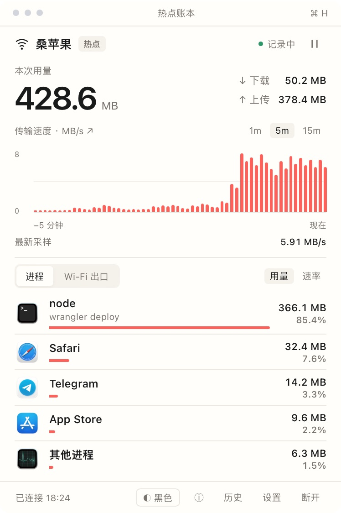

# 热点账本 / Hotspot Ledger

Mac 热点流量记录工具：应用排行、速度柱形图、用量提醒、手动与可选自动断连。同名热点、同一网卡下重启可续接记录，退出期间不补计。数据仅存本机，代理前后流量不能相加；统计不等同于运营商账单。

A local macOS hotspot usage monitor with per-app rankings, speed charts, usage alerts, manual Wi-Fi disconnection and optional automatic cutoff. Restarting on the same SSID and interface resumes the last interrupted record without inventing offline usage. Proxy traffic is not automatically attributed back to source apps. Statistics are estimates, not carrier billing data.



## 下载与介绍 / Download & website

- [Cloudflare Demo](https://hotspot-ledger.xiaosang.cc/)
- [GitHub Repo](https://github.com/holynova/hotspot-ledger)
- [Mac 下载 / Download v0.3.2](https://github.com/holynova/hotspot-ledger/releases/tag/v0.3.2)


v0.3.2：Apple Silicon，macOS 14+；本地签名，未通过 Apple 公证，首次打开可能被系统拦截。解压后拖入“应用程序”。确认来源和校验值后，可在系统“隐私与安全性”中允许打开，或自行构建。

Apple Silicon, macOS 14+. Ad-hoc signed, not Apple-notarized. Gatekeeper may block the first launch. Verify the source and release checksum before allowing it in Privacy & Security, or build locally.

## 本地运行 / Run locally

需要 Xcode Command Line Tools / Requires Xcode Command Line Tools.

```bash
bash scripts/build.sh test
bash scripts/build.sh
open dist/热点账本.app
# Website preview / 介绍页预览
npm run dev
```

## 发布 / Deploy

```bash
npm ci
npm run deploy:check
npm run deploy
```

Cloudflare Workers · Custom Domain: `hotspot-ledger.xiaosang.cc`

源码与部署配置统一在 main，本地手动发布，无 Cloudflare 自动部署。安装包构建后运行 `bash scripts/package.sh`。

Source and deployment configuration share `main`. Deploy manually from the same commit. Run `bash scripts/package.sh` after building for the release archive.

[详细说明 / Detailed guide](docs/USER-GUIDE.md)
