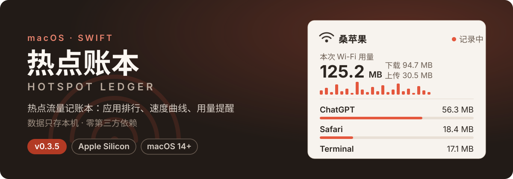
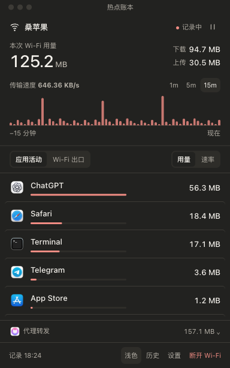

<p align="right"><a href="README.en.md">English</a></p>

<p align="center">
  
</p>

<p align="center">
  <a href="https://xiaosang.cc/hotspot-ledger/">🌐 产品介绍页</a>
  ·
  <a href="https://github.com/holynova/hotspot-ledger/releases/tag/v0.3.5">⬇ 下载 v0.3.5（Mac）</a>
  ·
  <a href="https://github.com/holynova/hotspot-ledger">GitHub 仓库</a>
</p>

热点账本是一款本机运行的 macOS 热点流量记录工具：连上手机热点后，它按应用排行记录流量、画出速度曲线，到达用量阈值时提醒你，必要时还可手动或自动关闭 Wi-Fi。数据只存本机，不上传。

## 截图

<p align="center">
  
  
</p>

## 功能

- **应用排行**：按用量列出各应用流量，带真实应用图标；辅助进程按应用包路径合并。
- **速度曲线**：密集柱形图看实时传输速度，悬停查看上传/下载，1m / 5m / 15m 切换。
- **用量提醒**：默认累计 500 MB、60 秒传输 100 MB 各提醒一次；填 0 可关闭对应提醒。
- **断连保护**：手动关闭 Wi-Fi，或开启自动关闭（默认关闭，独立阈值默认 1000 MB，每次连接最多尝试一次，执行前再次核对 Wi-Fi 名称）。
- **会话续接**：重启后若仍是同名热点、同一网卡，续接最近一次中断的记录；退出期间的流量不计入。
- **历史记录**：按连接保存历史会话，底部「历史」可切换查看。
- **代理区分**：Clash / Mihomo 转发流量单独标为「代理转发」，不自动分摊给源应用，也不与出口值相加。
- **菜单栏常驻**：关闭窗口仍继续采集，点菜单栏 Wi-Fi 图标重新打开；菜单栏直接显示当前用量。

## 统计口径

- **总量**：`netstat -ibn` 的 64 位接口计数差，十进制 MB/GB；包含局域网与协议开销，不等同于运营商账单。
- **进程**：系统 `nettop` 约每 2 秒采样一次，首次出现只建基线；短连接与进程退出可能漏记，是估计值而非精准审计。
- **网络身份**：SSID 经 CoreWLAN 获取（失败后试 `networksetup`）；读不到时明确停止自动计费，绝不猜测。
- **已知限制**：采样间隔超过 15 秒会拆分会话，间隔内用量不计入；历史会话最多保存 450 个速度点（约 15 分钟）。

## 下载与安装

下载 [v0.3.5](https://github.com/holynova/hotspot-ledger/releases/tag/v0.3.5)，解压后拖入「应用程序」。要求 Apple Silicon、macOS 14+。

> 本地 ad-hoc 签名，未通过 Apple 公证，首次打开可能被系统拦截。确认来源与校验值后，可在系统「隐私与安全性」中允许打开，或自行构建。

## 本地构建

需要 Xcode Command Line Tools。纯 Swift + 系统 SDK，零第三方运行依赖。

```bash
bash scripts/build.sh test   # 44 项核心测试
bash scripts/build.sh        # 产物：dist/热点账本.app
open dist/热点账本.app
```

界面预览（内存示例数据，不采集、不写盘、不操作 Wi-Fi）：

```bash
open dist/热点账本.app --args --preview
```

## 数据与隐私

- 记录存在本机 `~/Library/Application Support/Hotspot Ledger/ledger.json`，JSON 原子写入，文件权限 0600、目录 0700。
- 点击进程可看可执行文件、工作目录与可识别的任务类型；不保存完整命令行，避免把令牌和密码写进历史。
- 不安装登录项或后台守护服务；完全退出或重启后需手动打开。

详细说明见 [docs/USER-GUIDE.md](docs/USER-GUIDE.md)。

## 技术

- Swift + AppKit/SwiftUI，界面是本机 WKWebView 加载内置 HTML/CSS，采集、存储与断连由 Swift 执行。
- 窗口默认 384 × 614 px，浅色/深色双主题，单一珊瑚色强调。

```
Sources/App.swift         应用入口、菜单栏、窗口
Sources/Model.swift       会话模型与状态
Sources/Core.swift        统计核心：计数、提醒、断连判定
Sources/Sampler.swift     netstat / nettop 采样
Sources/Store.swift       本地 ledger.json 存储
Sources/WebDashboard.swift  WKWebView 仪表盘桥接
Resources/dashboard.html  界面（HTML/CSS）
Tests/CoreTests.swift     44 项核心测试
site/                     产品介绍页
```
